  

# 🌐 Awesome Customer &amp; Client Portal Ecosystem 🚀

  
  
  
  
  
  

> 🎯 **Curated Directory of Open-Source Customer &amp; Client Portals, Self-Hosted Client Workspaces, and White-Label B2B SaaS Platforms.**  
> *Everything you need for secure document vaults, onboarding pipelines, invoice self-service, and branded client hubs.*  
> **📅 Last updated: March 2026**

---

## 📖 Introduction &amp; SEO Overview

A **Client Portal** (or **Customer Portal**) provides external clients, partners, and customers with a centralized, branded, and encrypted web workspace to access confidential documents, track ongoing project milestones, review and settle invoices, execute digital contracts, and communicate asynchronously with service teams. 

Instead of dealing with scattered email threads, expired file-transfer links, and fragmented SaaS tools, modern businesses use client portal software to centralize interactions into a single self-service hub. Whether you are searching for **free self-hosted open-source client portal software** to ensure full data sovereignty (GDPR/HIPAA compliance) or an **all-in-one white-label SaaS client portal** for agencies and consultancies, this curated awesome list indexes the leading production-ready solutions ranked by community adoption and business scale.

---

## 📑 Table of Contents
- [📊 Sector Overview &amp; Market Dynamics](#-sector-overview--market-dynamics)
- [🏢 SaaS / Hosted Platforms](#-saas--hosted-platforms)
- [🔓 Open-Source GitHub Projects](#-open-source-github-projects)
- [📈 Star History](#-star-history)
- [🤝 How to Contribute](#-how-to-contribute)
- [💖 Support &amp; Sponsorship](#-support--sponsorship)
- [⚖️ Disclaimer](#️-disclaimer)

---

## 📊 Sector Overview &amp; Market Dynamics

The dedicated client portal software market is estimated at approximately **$2.5B–$3.8B** (scaling toward ~$8B+ over the next decade), situated within the broader **$25B+** customer self-service and enterprise web portal industry. The sector is **highly fragmented** rather than winner-take-all: vertical-specific compliance needs (legal, wealth management, accounting), distinct buyer personas (solopreneurs vs. mid-market agencies vs. global enterprises), and the rise of low-code/no-code platforms enable dozens of specialized and self-hosted tools to profitably coexist alongside enterprise suites.

---

## 🏢 SaaS / Hosted Platforms

*Commercial client portals offering turnkey hosted infrastructure, enterprise certifications, and managed white-labeling. Ranked by company scale (revenue &amp; valuation) in descending order.*

| 🏷️ Product | 💼 Company Scale (Revenue / Valuation) | 📝 Description | 💳 Pricing (Starting) | 🎁 Free Tier / Trial Limits |
|:---|:---|:---|:---|:---|
| **[Zoho Client Portal](https://www.zoho.com/)** | ~$1.5B Revenue / ~$12.5B Valuation | Client portal capabilities within the Zoho ecosystem (Zoho Desk / Zoho Creator). Provides self-service ticketing, knowledge base access, and custom client portals. | **$14/agent/month** (Zoho Desk Standard, annual) or **$8/user/month** (Zoho Creator Standard, annual) | **Free forever plan** (Zoho Desk: up to 3 agents with customer portal access; Zoho Creator: 1 app, 1 user) or **15-day free trial** |
| **[Softr](https://www.softr.io/)** | ~$50M–$100M Valuation ($15.7M Raised) | No-code platform for building client portals on top of Airtable, Google Sheets, or Softr Databases. Enables fully custom portals without engineering. AI features available on higher tiers. | **$19/month** (Basic plan, billed annually) or $25/month (monthly) | **Free forever plan** (up to 5 app users, 3 workspace builders, 5,000 records, Softr branding) |
| **[ClientPoint](https://www.clientpoint.com/)** | ~$45M Valuation / ~$6.3M ARR | Client portal and document automation platform focused on proposals, contracts, digital sales rooms, and client engagement. | Standard / Sales Accelerator: **$42/user/month** (billed annually) or $83/month flat starter | **Free forever plan** via ClientPoint.me (document sharing, chat, video meetings; 90-day message history limit) |
| **[Copilot](https://copilot.com/)** | ~$10M Series A / ~$3.9M ARR | Polished client portal focused on client experience for modern agencies and firms. Branded portal with messaging, billing, contracts, and files. | Starter: **$39/month** (billed annually, up to 50 clients); Professional: $89/month (up to 500 clients) | **14-day free trial** (full access to modular apps, no credit card required) |
| **[SuiteDash](https://suitedash.com/)** | ~$5.6M ARR (Bootstrapped) | All-in-one client portal with CRM, projects, invoicing, and deep white-labeling. Flat pricing with **unlimited users** on every plan. | Start: **$19/month** (unlimited users, 100 GB storage); Thrive: $49/month; Pinnacle: $99/month | **14-day free trial** of Pinnacle plan (unlimited users, no credit card required) |
| **[Clinked](https://www.clinked.com/)** | ~$3M ARR ($2.4M Raised) | Document-centric client portal with bank-grade security, granular permissions, audit trails, and compliance features. SOC 2 Type II certified. | Standard: **$239/month** (100 members, 1 TB storage); Premium: $479/month (250 members, 3 TB) | **10-day free trial** (access to core collaboration tools, no credit card required) |
| **[Onehub](https://www.onehub.com/)** | ~$1.5M ARR (Bootstrapped) | Secure file sharing with client branding. "A better Dropbox for clients" with proper permissions and client-side previews without downloads. | Standard: **$45/month** (includes 3 paid users, 200 total users, 50 workspaces, 1 TB storage) | **14-day free trial** (full access, no credit card required) |
| **[FuseBase (formerly Nimbus Platform)](https://nimbusplatform.com/)** | ~$1M ARR (Bootstrapped) | Client portal and project workspace with file sharing, messaging, and task tracking for agencies and professional services firms. | Solo: **$32/month** (billed annually); Essentials: $82/month | **Free forever plan** (1 client portal, 1 workspace, unlimited nested pages) or **14-day free trial** of paid tiers |
| **[Ahsuite](https://ahsuite.com/)** | ~$550K ARR (Bootstrapped) | Lightweight client portal designed for agencies and freelancers to embed reports, share files, and manage client approvals. | Grow: **$6.50/month** (billed annually) or $8/month (unlimited portals) | **Free forever plan** (up to 10 active client portals, task and file managers) |
| **[MyDocSafe](https://mydocsafe.com/)** | ~$500K ARR (Bootstrapped) | Secure document portal with e-signature, client onboarding, and compliance workflows for regulated industries. | Business Pro: **$25/user/month** (£18/user/month, billed annually, includes 200 guest users, 500 GB storage) | **30-day free trial** (unlimited e-signatures, no credit card required) |

---

## 🔓 Open-Source GitHub Projects

*Self-hosted, transparent, and privacy-respecting client portal software repositories on GitHub. Sorted in descending order by GitHub Stars.*

| 📦 Repository | ⭐ Star Badge | 📝 Architecture &amp; Key Features |
|:---|:---|:---|
| **[Invoice Ninja](https://github.com/invoiceninja/invoiceninja)** |  | **Comprehensive self-hosted invoicing &amp; client portal.** Built with Laravel &amp; Flutter. Features a dedicated client portal where customers view invoices, execute Stripe/PayPal payments, accept proposals, and track project tasks. |
| **[Crater](https://github.com/crater-invoice/crater)** |  | **Open-source invoice &amp; customer portal suite** for freelancers and small businesses. Laravel and VueJS backend/frontend with mobile apps (React Native), enabling clients to review quotes, statements, and payment histories directly. |
| **[ProjectSend](https://github.com/projectsend/projectsend)** |  | **Mature open-source file-sharing portal for clients (GPLv2).** Self-hosted PHP solution allowing teams to assign files to specific clients or groups with download logging, notifications, and custom branding. |
| **[ITFlow](https://github.com/itflow-org/itflow)** |  | **All-in-one open-source IT service management (ITSM) &amp; PSA with client portal.** Unifies client contact management, asset tracking, licensing, ticketing, and billing with a dedicated self-service customer portal. |
| **[FileRise](https://github.com/error311/FileRise)** |  | **Lightweight self-hosted file manager with dedicated client portals &amp; intake forms.** Provides dedicated client URLs (`/portal/<slug>`), upload/download permissions, custom branding, and intake forms capturing form submissions before upload. Docker &amp; Unraid ready. |
| **[PNLCS](https://github.com/Panelica/pnlcs)** |  | **Open-source WHMCS alternative (Laravel 13, MIT) with full client portal.** Complete web hosting management and billing client portal covering DNS, FTP, subdomains, tickets, and multi-gateway payments (Stripe, PayPal, Authorize.Net). |
| **[Atrium](https://github.com/Vibra-Labs/Atrium)** |  | **Modern self-hosted client portal for agencies and freelancers.** Manage active client projects, share assets, and give clients a branded dashboard to track progress in real-time. |
| **[Chargebee Customer Portal PHP](https://github.com/chargebee/customer-portal-php)** |  | **Open-source self-service customer portal** for subscription billing. Allows end-users to manage subscription plans, update payment methods, download tax invoices, and edit account details. |
| **[YetiForce Portal](https://github.com/YetiForceCompany/YetiForcePortal2)** |  | **Dedicated customer communication portal** built to complement the open-source YetiForce CRM. Provides customers with 24/7 ticket submissions, documentation access, and account records. |
| **[Sonar Customer Portal](https://github.com/SonarSoftwareInc/customer_portal)** |  | **Prebuilt ISP &amp; service provider customer portal.** Enables clients to monitor usage graphs, update billing information, review invoices, and submit support requests. |
| **[Simpler Development Portal](https://github.com/SimplerDevelopment/SimplerDevelopment)** |  | **Multi-tenant SaaS platform &amp; client portal.** Built with Next.js 16, React 19, Drizzle, and PostgreSQL. Features admin controls, per-tenant client portals, CRM, AI company brain, and Stripe billing. |
| **[Twenty CRM Client Portal](https://github.com/lilremark/twentycrmclientportal)** |  | **Self-hosted client portal powered by Twenty CRM.** Integrates directly with the open-source Twenty CRM API to grant clients real-time visibility into shared tickets and relationship records. |
| **[HostPanel](https://github.com/innovayse/hostpanel)** |  | **Open-source self-hosted billing &amp; client portal for web hosting companies.** Built with ASP.NET Core 9, Vue 3, and PostgreSQL, providing client self-service for invoicing, payments, and domain provisioning. |
| **[FlowEngine](https://github.com/FlowEngine-cloud/flowengine)** |  | **White-label client portal for automation agencies (n8n focus).** Self-hosted with Docker Compose. Manage workflows, invite clients with granular resource views, and process recurring billing via Stripe. |

---

## 📈 Star History

---

## 🤝 How to Contribute

Contributions are welcome and appreciated! To maintain the highest quality of entries:

1. 🍴 **Fork the repository** on GitHub.
2. 🌿 **Create a new branch** (`git checkout -b feature/add-new-portal`).
3. 📝 **Add or update entries** following the table structure above (factual descriptions, valid URLs, exact pricing / limits, and verified GitHub badges).
4. 🚀 **Submit a Pull Request** with a concise description of why the tool is valuable for the community.

---

## 💖 Support &amp; Sponsorship

If this curated repository saved you hours of research or helped you build a client portal, please consider supporting the project:

- ⭐ **Star this repository** to help others discover it.
- 🍴 **Fork and share** it with your developer network, agency peers, and colleagues.
- ☕ **Buy me a coffee / Sponsor the creator**: Support ongoing maintenance directly on the [GitHub Sponsors Dashboard](https://github.com/sponsors/ishandutta2007).

---

## ⚖️ Disclaimer

- This is an **independently curated community list** for educational and exploratory purposes—not a commercial endorsement.
- Client portals routinely handle sensitive personal data, financial documents, e-signatures, and corporate intellectual property. Always perform due diligence regarding encryption standards, role-based access controls (RBAC), and compliance mandates (GDPR, SOC 2, HIPAA).
- Commercial pricing and free-tier boundaries may be adjusted by vendors over time; check each official provider's website for real-time tier availability.

---

  Made with ❤️ for agency owners, developers, DevOps engineers, and service operations teams worldwide.

